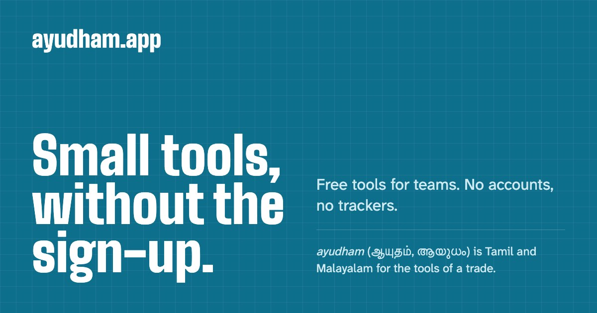
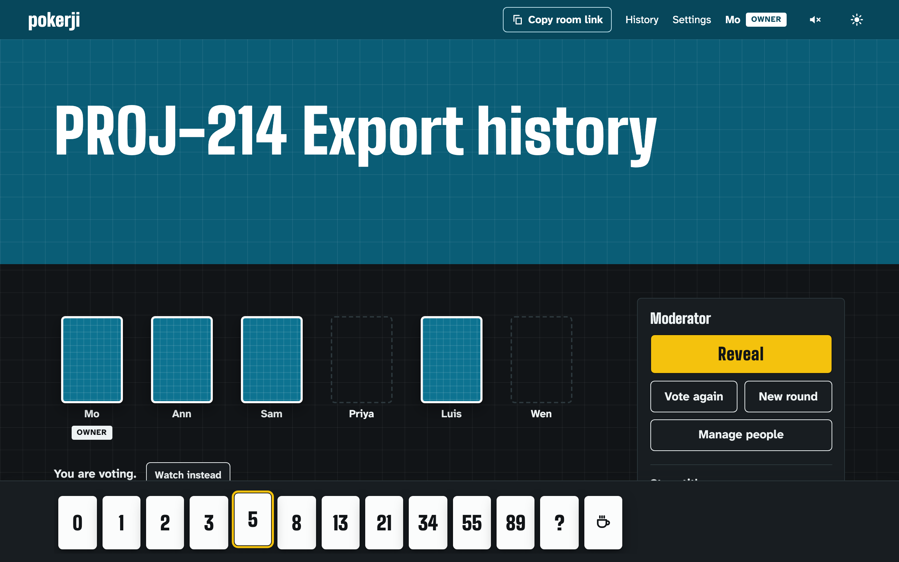
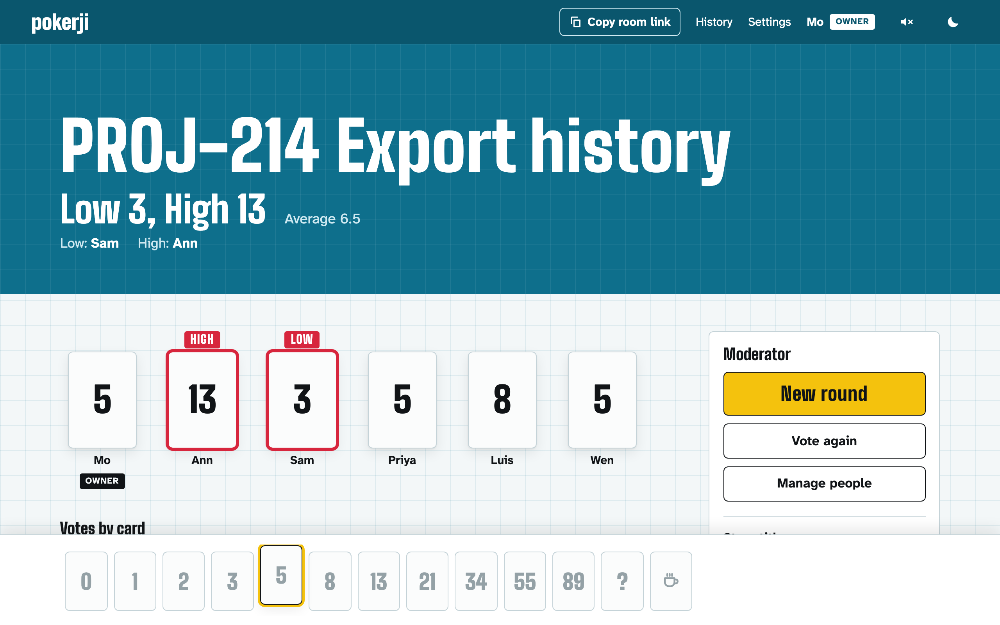
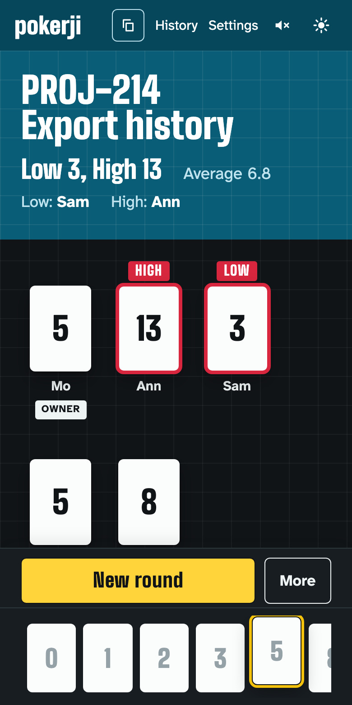

<p align="center">
  
</p>

<h1 align="center">pokerji</h1>

<p align="center">
  <b>Planning poker without the sign-up.</b><br>
  Create a room, share the link, estimate together in real time.<br>
  No accounts. No trackers. Nothing loaded from anyone else's servers.
</p>

<p align="center">
  <a href="https://github.com/santhoshjanan/pokerji/actions/workflows/release.yml?query=branch%3Amain"></a>
</p>

<p align="center">
  <a href="#run-it">Run it</a> ·
  <a href="#what-it-does">Features</a> ·
  <a href="#privacy">Privacy</a> ·
  <a href="docs/deploy.md">Deploying</a> ·
  <a href="LICENSE">MIT license</a>
</p>

---

pokerji is a small suite of free tools. The first is planning poker, shown here. The second is a [Schema.org markup builder](#the-markup-builder): fill in a form, copy JSON-LD for your own site. The third is a set of [text generators and converters](#the-text-tools): make a password or an identifier, or turn text into another form. The fourth is a [maker of barcodes and QR codes](#the-code-maker).

Estimation is judging, so pokerji looks like the judges' row at a diving meet: the story on a field of pool aqua, a row of white scorecards face down, and then every card turned in the same instant. The highest and lowest are flagged, because they speak first.

| Voting: cards stay face down | The reveal: every card at once |
|---|---|
|  |  |

<p align="center">
  
</p>

## What it does

- **A room is a link.** A 12-character secret link, with an optional passcode. Nobody signs up; you type a display name.
- **Secret votes, one reveal.** Nobody, the moderator included, can see a vote before the reveal. A 3-2-1 count, then every card turns at once.
- **High and Low speak first.** The outliers are flagged and named, so the conversation starts where it should.
- **Everything a round needs.** A prominent story title, a countdown timer, built-in and custom decks, voters and spectators, co-moderators, and "vote again".
- **History.** Each room keeps its rounds: the title, the result and who voted what. Anyone can remove their own name from past votes.
- **Opt-in sound.** Chopin or Bach during the countdown, a telegraph beep at its end, a tick on each beat of the reveal. Off until you turn it on.
- **Light and dark, desk and phone.** Both themes are built to the same standard, and the room works one-handed during a call.

## The markup builder

At `/schema`. Pick one of ten common types (organization, local business, website, breadcrumbs, article, FAQ page, product, event, person, recipe) or any other Schema.org type, fill in the form, and copy the JSON-LD as a script tag or as raw JSON. The form says what search engines require and recommend, and what is still missing. Several items can be built together and refer to each other.

It runs entirely in your browser. Nothing typed into it is sent to the server, and the server stores nothing for it; the draft is kept in the browser's own storage until you clear it.

## The text tools

At `/text`. Generators: passwords (with an exact strength figure and an option to leave out look-alike characters), passphrases from the EFF long word list, random strings in hex, Base64 and other alphabets, PINs and numbers, UUID v4 and v7, ULID and short identifiers, dice, coins and picks from a list. Converters: twelve case forms, slugs, Base64, hex, URL and HTML entity encoding both ways, SHA-2 hashes, line tools and counts.

They run entirely in your browser. Every random choice comes from the browser's cryptographic random source, without bias. Nothing typed or made is sent to the server, and nothing is stored anywhere.

## The code maker

At `/codes`. QR codes for a link, text, a business card (vCard or MECARD), an event, a Wi-Fi network, a place, an email, a text message or a phone number; and 2D codes (Micro QR, rectangular Micro QR, Data Matrix, Aztec, PDF417, MicroPDF417, MaxiCode, DotCode), product codes (EAN-13, EAN-8, UPC-A, UPC-E, ISBN, ISSN) and linear barcodes (Code 128, GS1-128, Code 39, Code 93, Interleaved 2 of 5, ITF-14, Codabar, GS1 DataBar). Matrix codes take themes, gradients, dot and corner shapes and a centre logo; every code takes colours and a quiet zone. Copy the image, or download PNG, JPG, SVG, PDF or all four in a ZIP.

It runs entirely in your browser: nothing typed, chosen or added is sent to the server, and nothing is stored anywhere. A logo is read on your device. Every style the page offers is decoded by the test suite, and the page says before export when a code may not scan.

## Privacy

Privacy is the product here, not a setting.

| | |
|---|---|
| **Nothing to sign up for** | No account, email or login anywhere |
| **Nothing from anyone else** | A strict Content Security Policy: fonts, scripts, images and audio are all served by the site itself |
| **Gone after 30 days** | A room and everything in it is deleted 30 days after it was last used, or at once by its owner |
| **Addresses are not stored** | Rate limits use a keyed hash that expires within the hour |
| **Nothing personal in the logs** | The app logs fixed descriptions of problems: no room links, names, titles or votes |

The privacy page in the app says exactly what is stored and for how long.

## Run it

You need Docker.

**Development.** The whole app, nothing to configure:

```bash
docker compose -f compose-dev.yaml up --build
```

Then open http://localhost:5173/poker.

**Production.** A bare-minimum file to adapt to your server:

```bash
cp .env.example .env   # set ORIGIN, POSTGRES_PASSWORD and ADDRESS_HMAC_SECRET
docker compose up -d --build
```

The app listens on port 3000 over plain HTTP. Put an HTTPS reverse proxy in front of it; [docs/deploy.md](docs/deploy.md) lists the three things that proxy must do.

## Metrics

Optional Prometheus metrics, off by default. Set `METRICS_PORT` and the app serves `GET /metrics` on that second port, for a Prometheus server on a private network. The public port never serves them. Every series is a total for the whole service, and no label carries anything about a room or a person. The full list is in [docs/deploy.md](docs/deploy.md#metrics-optional).

## Develop

Node 24 or later, and pnpm.

```bash
pnpm install
pnpm services:up                      # Postgres and Valkey for the tests
pnpm test                             # unit and integration tests
pnpm typecheck
pnpm --filter @pokerji/web e2e        # browser tests against a production build
```

To run the app outside Docker, copy the development lines from `.env.example` into `.env` and run `pnpm --filter @pokerji/web dev`.

## How it is built

| Part | What it is |
|---|---|
| [`packages/protocol`](packages/protocol) | Limits, decks and WebSocket message schemas shared by server and browser |
| [`packages/poker-engine`](packages/poker-engine) | The room's rules as a pure function: no I/O, no clock, no framework. Vote secrecy is enforced in one place here |
| [`packages/schema-builder`](packages/schema-builder) | The markup builder's rules as pure functions: the draft, the JSON-LD it becomes, the ten guided types, the checks, and a reader for the bundled Schema.org vocabulary |
| [`packages/text-tools`](packages/text-tools) | The text tools' rules as pure functions: unbiased sampling, the generators, the converters and a reader for the bundled word list |
| [`packages/code-maker`](packages/code-maker) | The code maker's rules as pure functions: content builders, the symbology catalogue, styling geometry, themes, scannability checks, and the SVG, PDF and ZIP writers; bwip-js is handed in, never imported |
| [`packages/poker-server`](packages/poker-server) | Everything that touches Postgres, Valkey, the clock or a socket |
| [`apps/web`](apps/web) | A thin SvelteKit app: pages, forms, the live room, and the pages of the markup builder, the text tools and the code maker |

Postgres holds rooms, sessions and history. Valkey holds rate-limit counters and room locks. One server instance holds the live rooms in memory.

Going deeper:

- [CLAUDE.md](CLAUDE.md): the architecture and the rules it keeps
- [DESIGN.md](DESIGN.md): the visual system, "Judges' Row"
- [docs/superpowers/specs](docs/superpowers/specs): the behaviour spec
- [docs/deploy.md](docs/deploy.md): running it in production

pokerji is the first tool in a planned suite of small tools for teams.

## Credits

- **Music.** Chopin recordings from [Musopen](https://archive.org/details/musopen-chopin), and Bach's Goldberg Variations played by Kimiko Ishizaka from the [Open Goldberg Variations](https://archive.org/details/The_Open_Goldberg_Variations-11823). Both are released under CC0; details are in [apps/web/static/audio/LICENSES.md](apps/web/static/audio/LICENSES.md).
- **Typefaces.** Big Shoulders and Atkinson Hyperlegible Next, self-hosted.
- **Codes.** Encoded by [bwip-js](https://github.com/metafloor/bwip-js), by Mark Warren, and packed by [fflate](https://github.com/101arrowz/fflate), by Arjun Barrett, both MIT, both served by the site itself.

## License

[MIT](LICENSE). The bundled recordings and typefaces keep their own terms, listed under Credits.

---

<p align="center">
  Made in New Jersey with ❤️<br>
  Check out <a href="https://phostrich.com">phostrich.com</a> and <a href="https://santhoshj.com">santhoshj.com</a>
</p>
